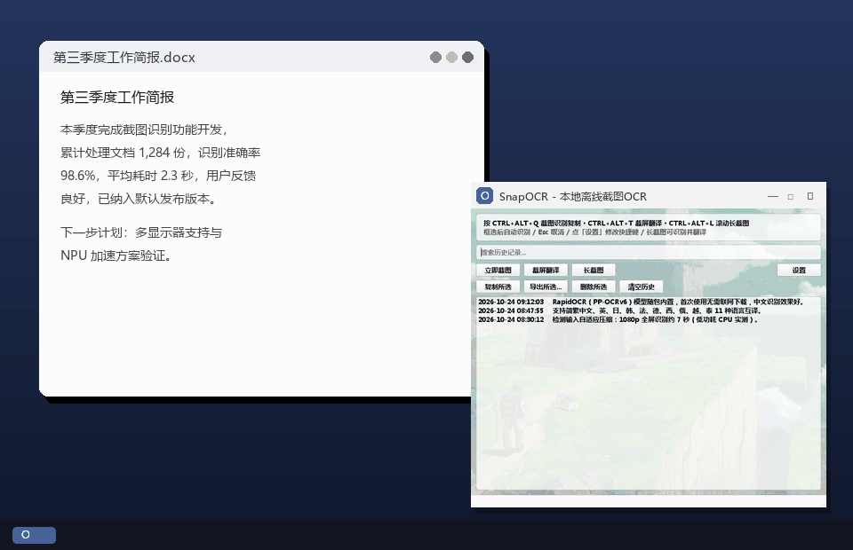
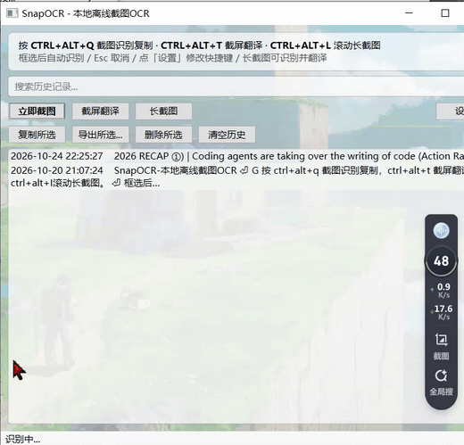
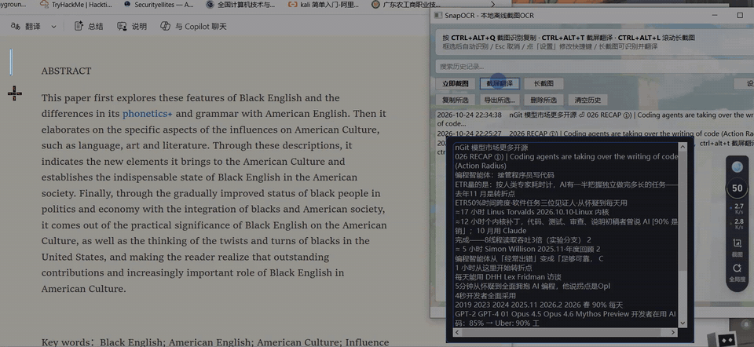

# SnapOCR — 本地离线截图 OCR

按一个热键，框选屏幕任意区域，文字自动识别并复制到剪贴板。**全程本地运行，不上传任何数据。**



## 特性

- 截图 → OCR → 复制剪贴板，一步完成（默认热键 `Ctrl+Alt+Q`）
- **截屏翻译**（默认热键 `Ctrl+Alt+T`）：框选 → 识别 → 自动弹出翻译窗口并翻译，原文可编辑重译
- **长截图**（默认热键 `Ctrl+Alt+L`）：框选区域后自动滚动拼接，整页可保存/复制图片，或直接「识别并复制」「识别并翻译」
- **翻译窗口**：粘贴/输入文本即时翻译，支持 11 种语言互译（免费接口，无需 API Key）
- **导出 txt/docx/pdf**：历史记录或译文可一键导出为文本、Word 或 PDF 文件
- **自定义快捷键**：主窗口「设置」或托盘菜单 →「快捷键设置」按键录制，自动保存并即时生效
- 基于 RapidOCR（PP-OCRv6 模型 / ONNXRuntime），中文识别效果好，**完全离线**
- 检测输入自适应压缩：1080p 全屏识别约 7 秒（低功耗 CPU 实测），框选小区域不受影响
- 智能按行还原排版，多栏文本不乱序
- 中文智能排版：自动去除中文字符间多余空格（托盘菜单可开关）
- 内置历史记录，支持关键词搜索，随时回溯、再次复制；长悬浮/双击条目浮窗预览完整内容
- 识别完成托盘气泡提示，支持最小化到托盘常驻
- 模型随包内置，首次使用无需联网下载

## 环境要求

- Windows 10/11（macOS/Linux 理论可用，未测试）
- Python 3.9+

## 快速开始

```bash
pip install -r requirements.txt
python entry.py
```

## 打包为单文件 exe

```bash
pip install pyinstaller
pyinstaller --noconfirm --windowed --name SnapOCR --collect-all rapidocr entry.py
```

生成 `dist/SnapOCR.exe`。

## 使用说明

| 操作 | 说明 |
| --- | --- |
| `Ctrl+Alt+Q` | 全局热键，开始截图（托盘菜单可改键） |
| `Ctrl+Alt+T` | 全局热键，截屏翻译（框选 → 识别 → 自动翻译） |
| `Ctrl+Alt+L` | 全局热键，滚动长截图（框选 → 点「开始」自动滚动拼接） |
| 拖拽 | 框选识别区域，松开即识别 |
| 双击 | 全屏识别 |
| `Esc` | 取消截图 |
| "截屏翻译"按钮/托盘菜单 | 点击后框选屏幕区域，识别并自动弹出翻译窗口 |
| 翻译窗口 | 截屏翻译后自动弹出，原文可编辑后点"翻 译"重译 |
| 翻译窗口 `Ctrl+Enter` | 快捷触发翻译 |
| "设置"按钮 / 托盘"快捷键设置" | 修改三个全局快捷键，保存后提示栏即时更新 |
| "导出所选..."按钮 | 把选中的历史记录导出为 txt / docx / pdf |
| 翻译窗口"导出..." | 把译文导出为 txt / docx / pdf |
| 长截图预览 | 保存 PNG / 复制图片 / 识别并复制 / 识别并翻译 |
| 历史搜索框 | 输入关键词即时过滤历史记录 |
| 托盘右键菜单 | 开关"识别后自动复制""中文智能排版"，以及"快捷键设置"（改后自动保存，即时生效，配置存于 `%APPDATA%\SnapOCR\settings.json`） |
| 双击历史条目 | 重新复制该条内容，并浮窗显示完整文本 |
| 长悬浮历史条目 | 停留约半秒，浮窗显示完整内容（文本可选中复制） |

## 效果演示

**长悬浮 / 双击历史条目** — 在网页上框选识别，文字自动进历史；长悬浮条目即可浮窗预览完整内容：



**截屏翻译** — 在网页上框选英文段落，识别后自动弹出翻译窗口，一键得到中文译文：



## 长截图说明

框选区域后会出现悬浮控制条：点「开始」自动注入滚轮下滚并逐帧拼接，滚到页面底部会自动结束（也可随时点「停止」），完成后弹出预览窗口，可保存 PNG、复制图片，或点「识别并复制」「识别并翻译」直接处理整页文字。相关参数（滚轮格数、滚动间隔、帧数/高度上限）见 `app/config.py` 的 `LONGSHOT_*` 常量。

已知限制：

- 固定页眉/悬浮元素会在每帧重复出现，导致拼接图中重复或错位
- 页面中有动画/视频的区域可能拼接不齐
- 仅支持主显示器；采集时会短暂接管鼠标滚轮

## 翻译说明

翻译使用免费公共接口，无需注册和 API Key：必应翻译为主（自动检测语言、无配额），MyMemory 自动兜底。目标语言默认中文简体，可在翻译窗口下拉切换（支持简繁中文、英、日、韩、法、德、西、俄、越、泰）。**注意：翻译功能需要联网**，OCR 识别本身仍然完全离线。

## 隐私

OCR 识别不联网、不上传，全部在本机完成。仅当使用翻译功能时，文本会发送到必应翻译 / MyMemory 公共接口。

## Roadmap

- [ ] 多显示器支持
- [ ] NPU / OpenVINO 加速
- [ ] 表格识别导出 Excel
- [ ] macOS / Linux 适配

## License

MIT
