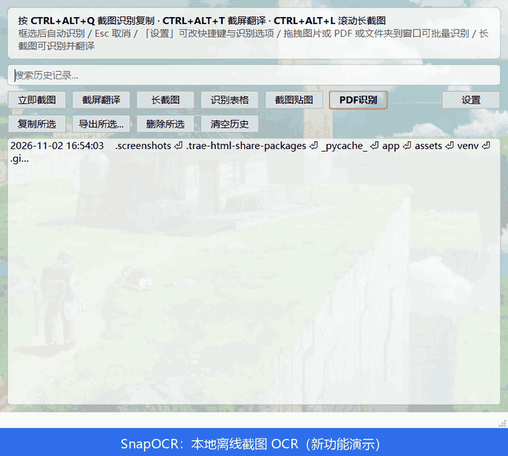
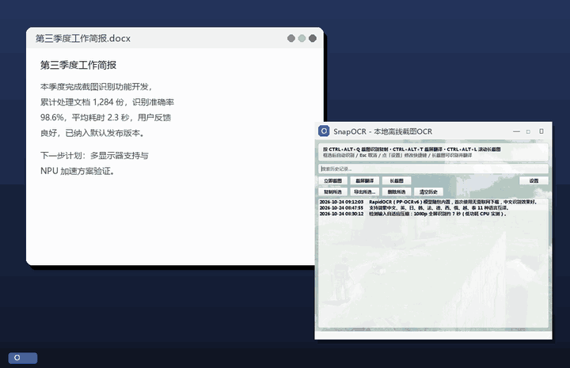
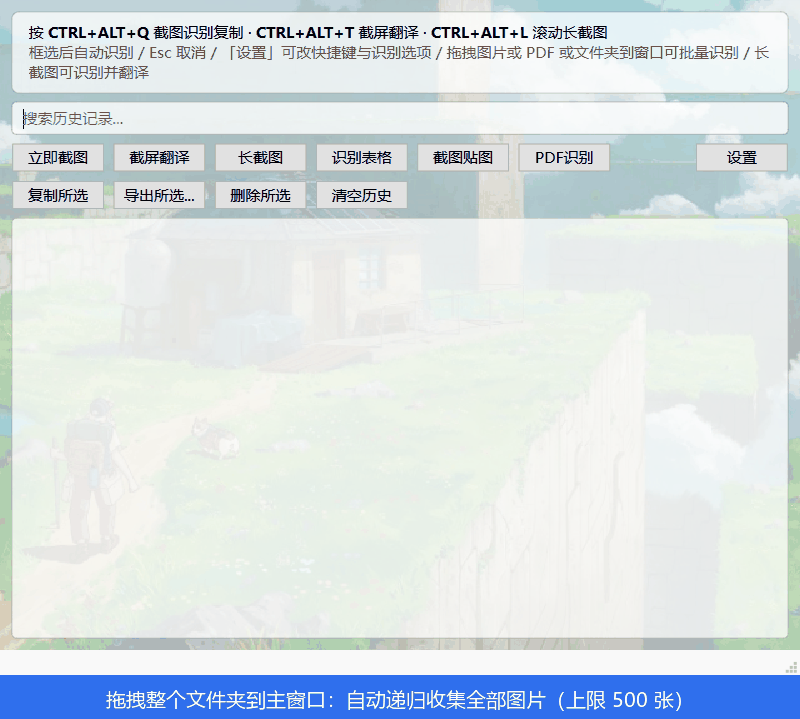
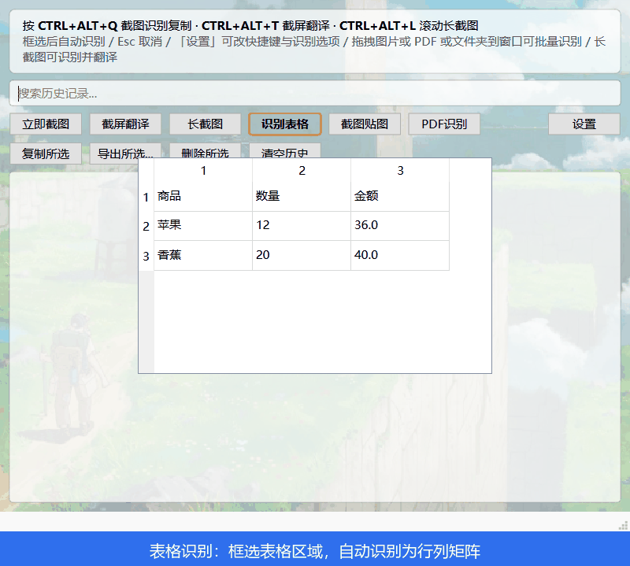
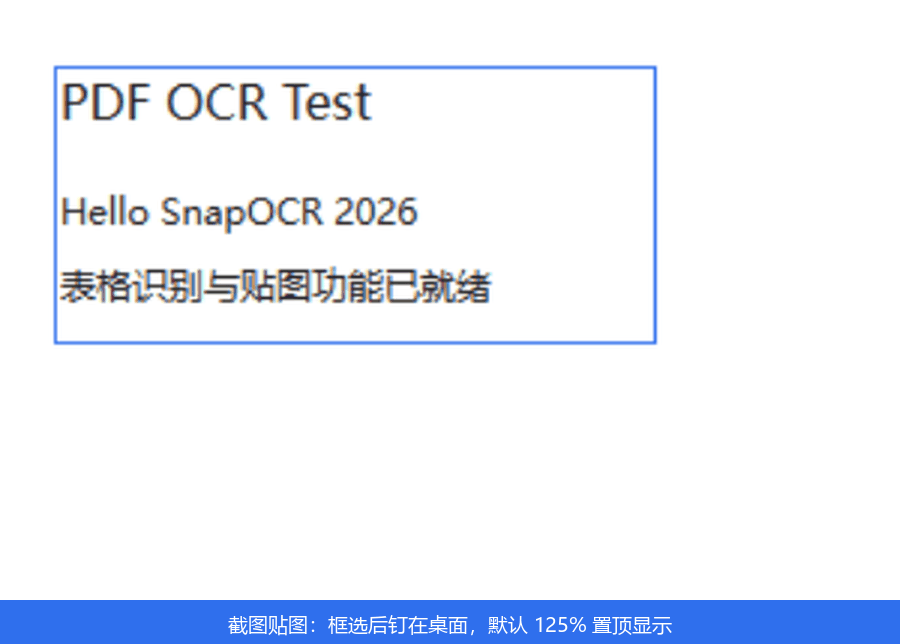
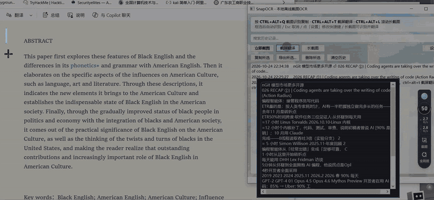
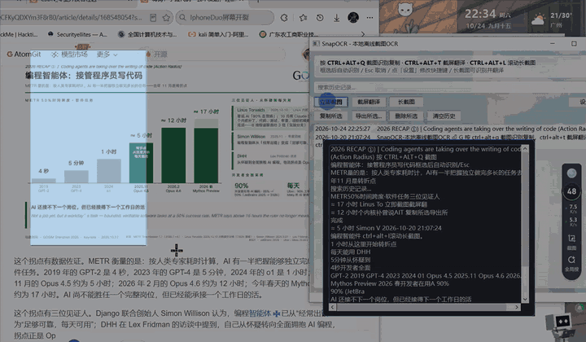

[中文] · [English](#snapocr--offline-screenshot-ocr)

<div align="center">


## SnapOCR 文字识别工具

[](LICENSE)
[](https://github.com/q037180/SnapOCR/stargazers)
[](https://github.com/q037180/SnapOCR/forks)
[](https://github.com/q037180/SnapOCR/issues)
[](#跨平台兼容性)

### [使用说明](#目录) · [安装](#安装) · [打包发布](#打包为单文件-exe) · [提交 Bug](https://github.com/q037180/SnapOCR/issues)

**免费，开源，完全离线的截图 OCR 工具**
适用于 Windows 10/11 x64 · Linux x64 · macOS

* **免费**：本项目所有代码开源，MIT 协议，完全免费。
* **离线**：OCR 引擎与语言模型全部本地运行，不上传任何数据。
* **高效**：基于 RapidOCR（PP-OCRv6 模型），1080p 全屏识别约 7 秒，框选小区域秒出。
* **灵活**：多语言模型、表格识别、批量识别、PDF 整档识别、翻译、贴图，一个不落。
* **功能**：截图 OCR / 批量 OCR / PDF 识别 / 表格转 Excel / 二维码 / 截屏翻译 / 长截图 / 贴图



</div>

## 目录

* [截图识别](#截图识别) — 热键框选、图像增强、段落合并、二维码
* [批量识别](#批量识别) — 拖入文件夹排队识别（Umi-OCR 批量OCR 同款）
* [PDF 整档识别](#pdf-整档识别) — 逐页渲染识别、进度可取消
* [表格识别](#表格识别) — 识别为行列矩阵，导出 Excel
* [截图贴图](#截图贴图) — 钉在桌面置顶，缩放调透明度
* [截屏翻译](#截屏翻译) — 框选即译，11 种语言互译
* [长截图](#长截图) — 自动滚动拼接整页
* [导出与历史](#导出与历史) — txt / docx / pdf / md / xlsx，搜索回溯
* [全局设置](#全局设置) — 快捷键、语言、功能开关
* [安装](#安装)
* [跨平台兼容性](#跨平台兼容性)
* [项目结构](#项目结构)
* [开发计划](#开发计划)

---

## 截图识别

按全局热键 `Ctrl+Alt+Q`（可改键）框选屏幕任意区域，松开即识别并复制到剪贴板：

- **多语言**：简中 / 繁中 / 英 / 日 / 韩 5 种模型内置，离线即用
- **图像增强**：深色主题截图自动反色、低对比度文本 CLAHE 增强，深色 IDE 识别率显著提升
- **段落合并**：多行文本自动合并为自然段；中文智能排版去除字间多余空格
- **二维码**：框选区域没有文字时自动兜底解码二维码
- **智能排版**：按行还原排版，多栏文本不乱序



## 批量识别

Umi-OCR「批量OCR」同款交互：把图片或整个文件夹拖进主窗口，自动加入批量队列（递归收集、去重、上限 500 张），点「开始识别」逐张处理，结果按文件名分组进入历史记录。



## PDF 整档识别

点「PDF识别」或直接把 PDF 拖进窗口，逐页渲染识别（≈144dpi），多页结果按「== 第 N 页 ==」分组，带进度条、可随时取消。

## 表格识别

框选表格区域 → 自动识别为行列矩阵 → 预览可编辑 → 一键保存 Excel（xlsx）。



## 截图贴图

框选后图片钉在桌面置顶显示，可同时钉多张：拖动移动、滚轮缩放、`Ctrl+滚轮` 调透明度、双击或右键关闭。



## 截屏翻译

热键 `Ctrl+Alt+T` 框选英文段落 → 识别 → 自动弹出翻译窗口得到中文译文。原文可编辑后重译，支持简繁中文、英、日、韩、法、德、西、俄、越、泰 11 种语言互译（必应翻译为主，MyMemory 兜底，免费无需 API Key）。



## 长截图

热键 `Ctrl+Alt+L` 框选区域后自动注入滚轮下滚、逐帧拼接，滚到页面底部自动结束。整页可保存 PNG / 复制图片，或直接「识别并复制」「识别并翻译」。

已知限制：固定页眉会重复出现；动画/视频区域可能拼接不齐；自动滚动依赖 Win32（Linux/macOS 下给出提示，算法本身跨平台）。

## 导出与历史

- 内置历史记录，关键词搜索即时过滤；单击条目浮窗预览，双击再次复制
- 「导出所选...」一键导出 **txt / docx / pdf / md**；表格结果可保存 **xlsx**



## 全局设置

主窗口「设置」或托盘菜单打开，侧边栏三页：

| 页 | 内容 |
| --- | --- |
| 快捷键 | 主截图 / 截屏翻译 / 长截图热键录制，即时生效 |
| 识别 | 语言、角度分类、图像增强、段落合并、GPU 加速 |
| 功能 | 二维码、表格识别、PDF识别、截图贴图、水印关键词过滤 |

配置持久化于 `%APPDATA%\SnapOCR\settings.json`。

## 安装

### 方式一：下载 exe（推荐，免安装）

到 [Releases](https://github.com/q037180/SnapOCR/releases) 下载 `SnapOCR.exe`，双击即用——无需安装 Python，内置中文模型，完全离线。

### 方式二：从源码运行

```bash
pip install -r requirements.txt
python entry.py
```

- 环境要求：Python 3.9+；Windows 10/11（完整支持），Linux / macOS 大部分功能可用
- 首次运行无需联网下载模型，开箱即用

## 跨平台兼容性

| 功能 | Windows | Linux | macOS |
| --- | --- | --- | --- |
| 截图识别 / 翻译 / 历史 / 批量识别 | ✅ | ✅ | ✅ |
| PDF 整档识别 / 表格 / 贴图 / 导出 | ✅ | ✅ | ✅ |
| 全局热键 | ✅ | ⚠️ 需 sudo 运行，失败时自动降级为按钮/托盘触发 | ⚠️ 需在 系统设置→隐私与安全→辅助功能 授权 |
| 长截图自动滚动 | ✅ | ❌ 启动时提示（依赖 Win32 滚轮注入） | ❌ 同左 |
| GPU 加速 | CUDA / DirectML | CUDA（onnxruntime-gpu） | CPU（可装 onnxruntime-coreml） |

在目标平台上运行自检脚本即可确认：

```bash
python tests/platform_check.py
```

热键或长截图不可用时程序不会崩溃：GUI 按钮、托盘菜单均照常工作。

## 项目结构

```
SnapOCR/
├─ entry.py               # 程序入口（支持 --smoke 冒烟自检）
├─ app/
│  ├─ main.py             # 应用组装与生命周期
│  ├─ config.py           # 常量与 settings.json 持久化
│  ├─ core/
│  │  ├─ engine.py        # RapidOCR 封装：多语言 / 增强 / 段落 / 表格 / 二维码
│  │  ├─ pdf_ocr.py       # PDF 整档识别线程
│  │  ├─ stitcher.py      # 长截图滚轮采集与拼接算法
│  │  ├─ translator.py    # 免费翻译接口（必应 + MyMemory）
│  │  └─ exporter.py      # txt / docx / pdf / md / xlsx 导出
│  └─ ui/
│     ├─ main_window.py   # 主窗口：标签页 / 批量队列 / 托盘 / 热键
│     ├─ capture_overlay.py  # 截图遮罩与框选
│     ├─ longshot.py      # 长截图控制条与预览窗
│     ├─ pin_window.py    # 置顶贴图窗口
│     ├─ preview_popup.py # 历史条目浮窗预览
│     ├─ settings_dialog.py  # 侧边栏设置页
│     └─ translate_dialog.py # 翻译窗口
├─ assets/                # 演示 GIF 与图标
├─ tests/platform_check.py   # 跨平台自检脚本
├─ tools/make_demo_gif.py    # 演示 GIF 自动生成脚本
└─ requirements.txt
```

## 开发计划

已完成：

- [x] 多语言识别（5 种模型内置）
- [x] 图像增强 / 段落合并 / 水印过滤
- [x] 表格识别导出 Excel
- [x] PDF 整档识别（进度可取消）
- [x] 截图贴图（Umi-OCR 同款）
- [x] 批量识别页（Umi-OCR 批量OCR 同款交互）
- [x] Markdown 导出
- [x] 截屏翻译 / 长截图 / 二维码
- [x] Linux / macOS 兼容

远期计划：

- [ ] 多显示器支持
- [ ] NPU / OpenVINO 加速
- [ ] 公式识别

## 隐私

OCR 识别不联网、不上传，全部在本机完成。仅当使用翻译功能时，文本会发送到必应翻译 / MyMemory 公共接口。

## License

[MIT](LICENSE)

## SnapOCR — Offline Screenshot OCR

Press one hotkey, drag a box anywhere on screen, and the text is recognized and copied to your clipboard. **Runs fully offline.**

- Multi-language models (zh-CN / zh-TW / EN / JA / KO) bundled
- Batch OCR page (Umi-OCR style queue), whole-PDF OCR, table → Excel, pinned captures, screen translation, scrolling long-shot, export to txt/docx/pdf/md/xlsx

```bash
pip install -r requirements.txt
python entry.py
```
